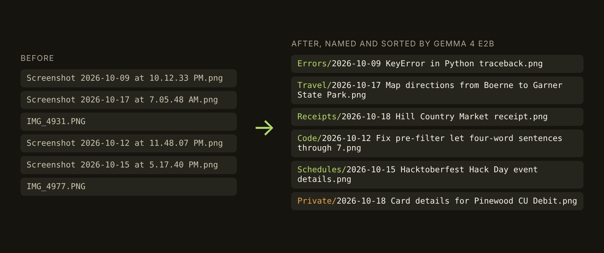

# Screenshot Sloth

Your screenshots get real names while you do nothing.

Live app: https://anudeep-bonagiri.github.io/screenshot-sloth/



Point it at the folder your screenshots land in. Google's open-weight Gemma 4 E2B runs on your GPU inside the browser tab, looks at each image, and gives it a name you could search for: `Screenshot 2026-10-09 at 10.12.33 PM.png` becomes `Errors/2026-10-09 KeyError in Python traceback.png`. It sorts the files into folders by type, can move ones that show a password or card number into a `Private` folder, and can keep watching the folder so new screenshots get renamed as they arrive. Nothing is uploaded.

## How it works

1. Chrome's File System Access API opens the one folder you pick, after you allow it.
2. Each image goes to a Web Worker running Gemma 4 E2B (4-bit, about 3.1 GB) through Transformers.js 4.3.1 on WebGPU. The model answers in three lines: a title, a type, and whether the image shows a secret.
3. Ordinary code does everything that touches a file. The date comes from the old name (or the file's modified time for `IMG_1234.PNG`), the title is cleaned for every file system, collisions get `(2)`, and the file is moved. Every move is written to `screenshot-sloth-log.csv` in the folder, and the page has an undo button for the last batch.

The privacy claim is enforced by the browser. `index.html` sets a Content Security Policy that only allows connections to this site, the jsDelivr CDN (library code) and Hugging Face (model weights). The worker is started from a blob URL so it inherits the same policy. The "Run the privacy test" button tries to reach an outside server from the page and from the worker and passes only if the browser reports that it blocked both.

There is no build step and no backend. The 4-bit weights need an operator that the WebAssembly backend lacks, so the app requires WebGPU (Chrome or Edge on a laptop or desktop).

## Test results

The screenshots are made up. `eval/fixtures.mjs` and `eval/fixtures-holdout.mjs` hold them as HTML, and `scripts/make-shots.mjs` renders them to PNG at Mac (2x) and iPhone (3x) density. Each one is labeled with its type, whether it shows a secret, and the words a useful name has to contain.

The model numbers below come from `scripts/eval-run.mjs`, which runs the same prompt and parser as the app with onnxruntime on a 2-core cloud CPU. That is why the times are slow. `bench.html` runs the same screenshots through the app's own WebGPU worker.

### Round one: naming and sorting (22 test screenshots)

The prompt was written against 10 dev screenshots, scored 10 of 10 there, and was frozen before the 22 test screenshots were run.

| System | Useful names | Right folder | Secrets caught | False alarms | Time each |
|---|---|---|---|---|---|
| Gemma 4 E2B q4, 280 image tokens | 19 of 22 | 16 of 22 | 3 of 5 | 0 | 27.5 s (CPU) |
| Gemma 4 E2B q4, 140 image tokens | 19 of 22 | 13 of 22 | 3 of 5 | 0 | 17.9 s (CPU) |
| Tesseract OCR + keyword rules | 11 of 22 | 19 of 22 | 5 of 5 | 1 | 0.5 s |

"Useful names" is strict: a name passes only if it contains a word from every group in the label. The three Gemma names that failed were "Harborlight Inn Mission District Booking Confirmation" (the label wanted "San Francisco"), "Activities and Grading for CS 3733" (the label wanted "syllabus" or "course") and "Fix pre-filter: let four-word sentences through #7" (the label wanted "pull request"). The OCR names are the first line of text with three or more words, which is often a URL bar.

The keyword rules won on sorting and on secrets, and that comparison is not fair to the model: I wrote the rules while looking at these labels. They did worse on the later rounds below, which I made after the rules were written.

### Rounds two and three: the private check

Round one showed the model missing an API key in a `.env` file and a Wi-Fi password in a group chat. So I tried two fixes and made new screenshots to test them.

`v2` changes the last line of the prompt: instead of answering yes or no, the model must copy the secret it sees. A secret-shape check (`looksSecret()` in `src/core.js`) then decided whether the copied text looked like a password, key or code. Round two (10 screenshots: 5 secrets, 5 traps that talk about secrets without showing one) was made before v2 ran on anything. The shape check was written after reading rounds one and two, and round three (10 more, some built to be hard for it, like a 4-digit code and a passphrase with no digits) was made after the check and before it ran.

| Private check | Round one | Round two | Round three | All 15 secrets | False alarms on 27 ordinary shots |
|---|---|---|---|---|---|
| v1: PRIVATE yes/no | 3 of 5, 0 false | 2 of 5, 0 false | 2 of 5, 0 false | 7 of 15 | 0 |
| v2: copy the secret | 5 of 5, 6 false | 5 of 5, 3 false | 4 of 5, 2 false | 14 of 15 | 11 |
| v2 + shape check | 5 of 5, 0 false | 5 of 5, 0 false | 2 of 5, 2 false | 12 of 15 | 2 |
| Tesseract OCR + rules | 5 of 5, 1 false | 4 of 5, 3 false | 2 of 5, 3 false | 11 of 15 | 7 |

The shape check was perfect on the screenshots it was written against and worse than no check at all on new ones, so it is not in the app. The app offers v1 as "Careful" (the default) and v2 as "Catch more". Neither is a security tool. When v2 copies a secret, the worker drops the copied text immediately; it is never shown or stored.

The labels and the screenshots were written by the same person who wrote the prompts. Treat these numbers as a sanity check, not a benchmark.

Raw answers for every run are in `eval/results/`. To reproduce a row: `node scripts/score.mjs eval/results/e2b-280-v1-test.json test`.

## Run it yourself

```
git clone https://github.com/anudeep-bonagiri/screenshot-sloth
cd screenshot-sloth
python3 -m http.server 8765
```

Open http://localhost:8765 in Chrome or Edge. For the in-browser benchmark, open `bench.html`.

The Node scripts need `npm install`. `npm run shots` renders the screenshots, `node scripts/eval-run.mjs test 280 v1` runs the model on the CPU, `python3 scripts/baseline_ocr.py` runs the OCR baseline (needs Tesseract), and `node scripts/test-app.mjs` checks renaming, sorting, collisions and undo in headless Chromium using the browser's private file system.

## Layout

```
index.html, bench.html   the app and the benchmark page
sw.js                    service worker; caches the app shell for offline use
src/core.js              screenshot name patterns, dates, both prompts, parser, file naming
src/worker.js            loads Gemma 4 E2B and describes one image at a time
src/app.js               folder access, queue, rename, undo, watch mode
src/bench.js, score.js   in-browser benchmark and shared scoring
eval/                    labeled screenshots as HTML, and raw results
samples/                 the rendered screenshots
scripts/                 rendering, CPU evaluation, OCR baseline, scoring, app test
```

## License

MIT for the code. Gemma 4 is released by Google under Apache 2.0.
